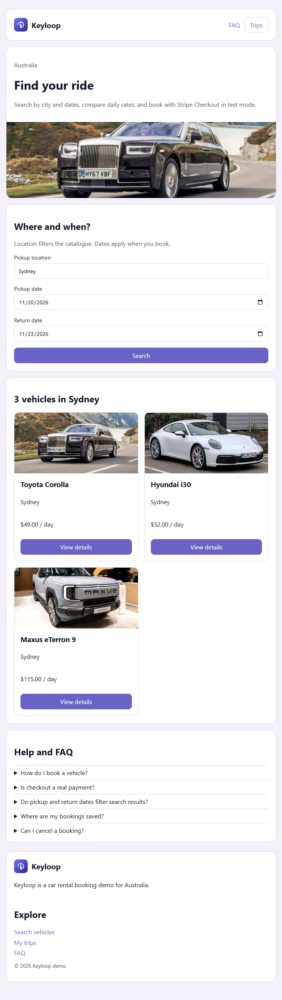
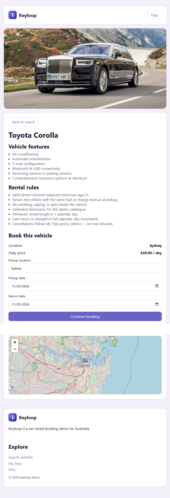
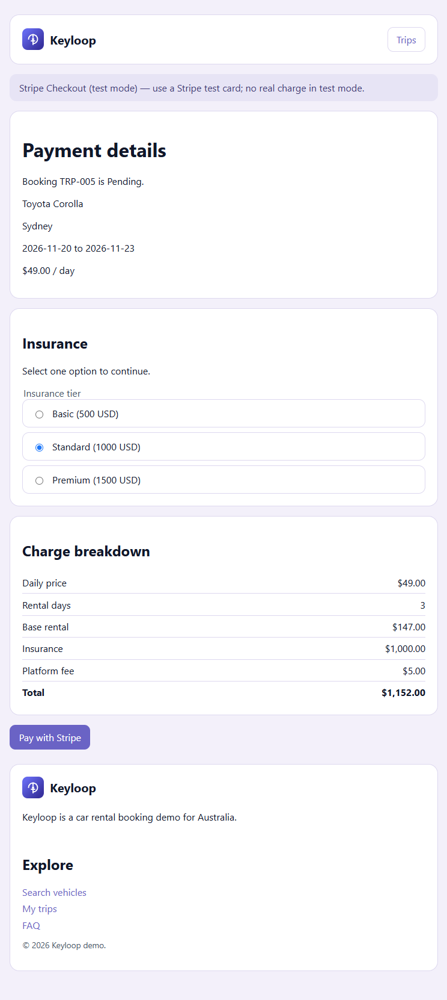
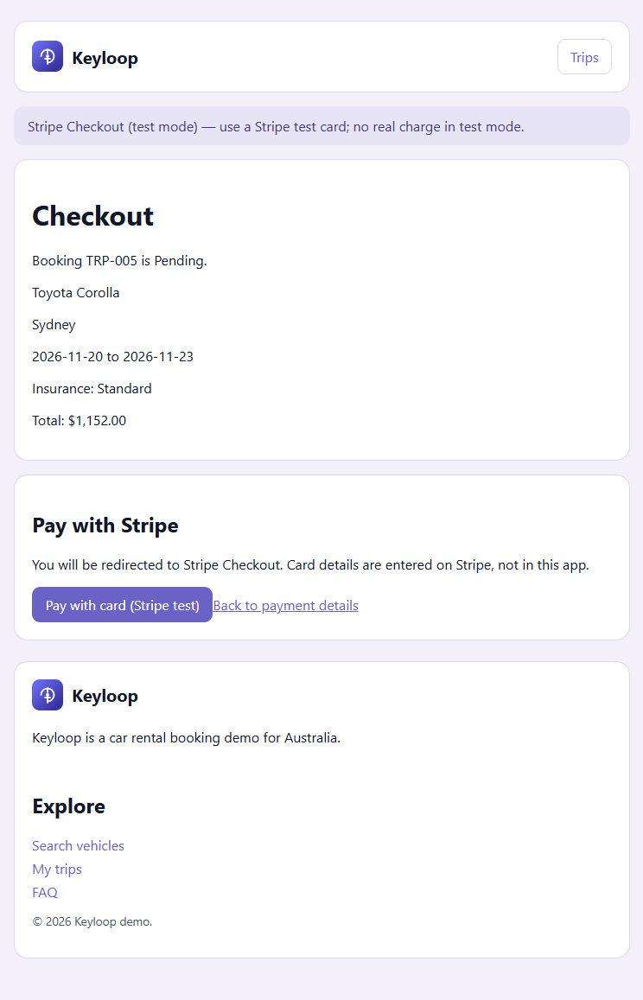
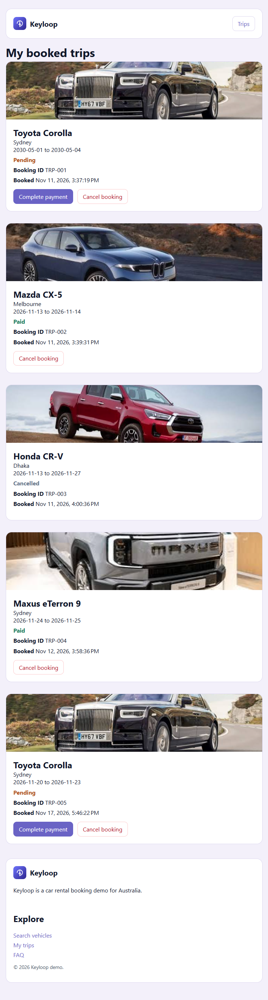
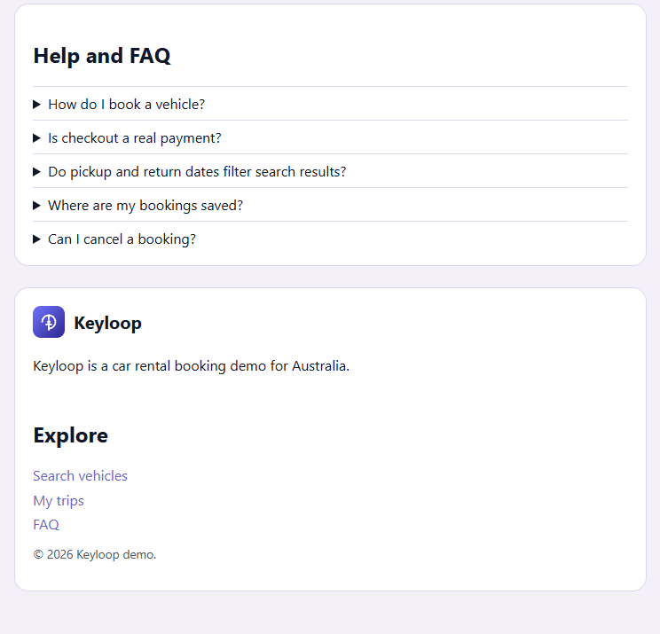

# Keyloop UI reference

This folder is the screen and workflow index for the Keyloop car-rental demo. It describes the Angular client as it exists in this repository. Screenshots of the main booking flow are in [`ui-references/`](./ui-references/README.md).

## Project overview

Keyloop is a browser demo for booking a rental car in Australia. A renter searches a vehicle catalogue, opens a vehicle, creates a booking, chooses insurance, and pays with Stripe Checkout in test mode. The Angular app never collects card numbers. Stripe hosts the card form.

The client runs at `http://localhost:4200`. The API runs at `http://localhost:5077`.

## Frontend technology and architecture

The client is an Angular 21 standalone SPA. TypeScript sources live under [`client/src/app/`](../client/src/app/).

| Area | Path | Role |
|------|------|------|
| Routes | [`client/src/app/app.routes.ts`](../client/src/app/app.routes.ts) | Maps URLs to page components |
| Shell | [`client/src/app/app.ts`](../client/src/app/app.ts) | Skip link, router outlet, site footer |
| Feature pages | [`client/src/app/features/`](../client/src/app/features/) | One folder per route screen |
| Shared UI and services | [`client/src/app/core/`](../client/src/app/core/) | Logo, footer, FAQ, map, HTTP services, models |

Pages are standalone components. Landing uses an external template ([`landing.page.html`](../client/src/app/features/landing/landing.page.html)). The other four pages keep their templates in the component file. Shared visual styles use the `kl-*` class names.

The API is an ASP.NET Core 8 app in [`server/Keyloop.Api/`](../server/Keyloop.Api/). Catalogue, app config, insurance tiers, and bookings are EF Core entities. Development may use the in-memory provider or PostgreSQL.

## Main application modules

These match the construction units in [`memory-bank/intents/001-keyloop-rental-demo/units.md`](../memory-bank/intents/001-keyloop-rental-demo/units.md).

| Module | What the UI does |
|--------|------------------|
| Platform shell | Skip link, page header, Trips link, site footer, landing FAQ |
| Catalog search | Landing search form, URL query sync, vehicle result grid |
| Vehicle booking | Vehicle detail and creation of a Pending booking |
| Insurance and pricing | Tier choice and charge breakdown on payment details |
| Stripe payment | Redirect to Stripe Checkout and the checkout return screen |
| My trips | Trip list from the bookings API, resume payment, cancel |

## UI navigation structure

Every feature page repeats a header: the Keyloop logo (links home) and a **Trips** link to `/trips`. The landing header also has an **FAQ** link to `/#faq`.

The site footer is on every route. Its links are **Search vehicles** (`/`), **My trips** (`/trips`), and **FAQ** (`/#faq`).

Unknown paths redirect to `/`.

| Route | Screen | Title |
|-------|--------|-------|
| `/` | Browse vehicles | Keyloop – Browse vehicles |
| `/vehicles/:id` | Vehicle details | Keyloop – Vehicle details |
| `/bookings/:bookingId/payment` | Payment details | Keyloop – Payment details |
| `/bookings/:bookingId/checkout` | Checkout | Keyloop – Checkout |
| `/trips` | My booked trips | Keyloop – My booked trips |

## User roles

There is one role: an anonymous renter. The app has no accounts, tokens, or saved cards. Anyone who can open the site can search, book, pay in test mode, and see the bookings the API returns for this demo.

## Major business workflows

### Search the catalogue

1. On **Browse vehicles**, the renter enters a pickup location, pickup date, and return date.
2. **Search** writes `location`, `pickupDate`, and `returnDate` onto the URL and reloads the form from those query params.
3. Location filters `GET /api/vehicles`. Dates are validated. Dates do not filter the vehicle list.
4. Each result card links to **Vehicle details** and carries the same query params.

### Create a booking

1. **Vehicle details** shows features, rental rules, location, daily price, a location map, and the same date fields.
2. **Continue booking** is enabled when the vehicle has loaded and the dates pass validation.
3. The page posts the booking to `POST /api/bookings` and opens **Payment details** for the new id.

### Choose insurance and pay

1. **Payment details** shows the booking id, status, vehicle, location, and dates, plus a Stripe test-mode notice.
2. While the booking is Pending, the renter selects Basic, Standard, or Premium. Labels and amounts come from `GET /api/config`.
3. The charge breakdown shows daily price, rental days, base rental, insurance, platform fee, and total. The fee amount comes from app config.
4. **Pay with Stripe** saves the tier and sends the browser to the Stripe Checkout URL returned by the API. The app does not render card fields.

### Return from Stripe

1. Stripe sends the browser back to **Checkout**.
2. `stripe=cancelled` shows “Payment was cancelled. You can try again.” and leaves **Pay with card (Stripe test)** available.
3. `stripe=success` with `session_id` asks the API to verify the session. A matching paid result shows “Payment successful. Your booking is now Paid.” and a link to **My booked trips**.
4. A Pending booking that has no insurance tier is sent back to **Payment details**.
5. A Cancelled booking shows “This booking was cancelled and cannot be paid.”

### Review trips

1. **My booked trips** lists bookings from `GET /api/bookings`.
2. An empty list shows “You haven't booked any trips yet” and **Browse vehicles**.
3. A Pending trip has **Complete payment**, which opens **Payment details**.
4. Pending and Paid trips have **Cancel booking**. The browser confirm dialog warns that a paid cancellation in this demo does not issue a refund. Cancelled trips stay in the list with status Cancelled and no cancel or pay action.

## UI screen reference index

The images below were captured from the local app (`http://localhost:4200`) on 17 November 2026. The walkthrough searched Sydney for 20–23 November 2026, opened the Toyota Corolla, created booking TRP-005, and selected Standard insurance. See [Capture notes](#capture-notes).

### Browse vehicles



- Route: `/`
- Module: Catalog search
- Purpose: Search the catalogue and open a vehicle.
- Main elements: header, hero (“Find your ride”), location and date form, result grid with photo, name, location, daily price, FAQ section, site footer.
- Actions: Search; open FAQ; open Trips; View details for a vehicle.
- States in the template: “Searching…”, “Loading vehicles…”, load error asking whether the API is on port 5077, date validation message, “No vehicles match your search.” when a location filter returns nothing, and “No vehicles to show. Try another city or clear your search.” when the grid is empty.
- Related screens: Vehicle details, My booked trips, Help and FAQ.
- Workflow: Search the catalogue.
- Implementation status: Implemented. Route and [`landing.page.html`](../client/src/app/features/landing/landing.page.html) exist.

### Vehicle details



- Route: `/vehicles/:id`
- Module: Vehicle booking
- Purpose: Show one vehicle and start a booking.
- Main elements: photo, features, rental rules, location, daily price, pickup location, pickup date, return date, location map.
- Actions: Back to search (keeps the search query); Continue booking; open Trips.
- States in the template: “Loading vehicle…”, “Vehicle not found.”, date validation message, “Could not save this booking.”
- Related screens: Browse vehicles, Payment details, My booked trips.
- Workflow: Create a booking.
- Implementation status: Implemented. Route and [`vehicle-detail.page.ts`](../client/src/app/features/vehicle-detail/vehicle-detail.page.ts) exist.

### Payment details



- Route: `/bookings/:bookingId/payment`
- Module: Insurance and pricing, Stripe payment
- Purpose: Choose insurance, show the charge breakdown, and start Stripe Checkout.
- Main elements: test-mode notice, booking summary, insurance radios, charge breakdown.
- Actions: select Basic, Standard, or Premium; Pay with Stripe; open Trips. The not-found state also links to Landing.
- States in the template: “This booking was not found.”, pricing or vehicle load errors, “Opening Stripe…”, “Pay with Stripe” disabled until a Pending booking has a tier and a breakdown.
- Related screens: Vehicle details, Checkout (via Stripe), My booked trips, Browse vehicles.
- Workflow: Choose insurance and pay.
- Implementation status: Implemented. Route and [`payment-details.page.ts`](../client/src/app/features/payment-details/payment-details.page.ts) exist.

### Checkout



- Route: `/bookings/:bookingId/checkout`
- Module: Stripe payment
- Purpose: Summarize the booking and finish or retry Stripe Checkout.
- Main elements: test-mode notice, booking id, status, vehicle, location, dates, insurance tier, total.
- Actions: Pay with card (Stripe test); Back to payment details; open Trips. After success, the pay button is replaced by the success message and a Trips link. The not-found state links to Trips and Landing.
- States in the template: cancelled payment, payment success, cancelled booking, missing checkout URL, Stripe configuration error, verification failure.
- Related screens: Payment details, My booked trips, Stripe Checkout (external).
- Workflow: Return from Stripe.
- Implementation status: Implemented. Route and [`checkout.page.ts`](../client/src/app/features/checkout/checkout.page.ts) exist. The Stripe-hosted card page is outside this repository and has no local screenshot.

### My booked trips



- Route: `/trips`
- Module: My trips
- Purpose: List bookings and resume or cancel them.
- Main elements: trip card with image, vehicle name, location, dates, status badge (Pending, Paid, Cancelled), booking id, booked timestamp.
- Actions: Complete payment (Pending only); Cancel booking (Pending and Paid, after `confirm`); Browse vehicles when the list is empty; open Trips (current page).
- States in the template: “Loading trips…”, “Could not load trips.”, “You haven't booked any trips yet”, “Could not cancel this booking.”
- Related screens: Browse vehicles, Payment details.
- Workflow: Review trips.
- Implementation status: Implemented. Route and [`my-trips.page.ts`](../client/src/app/features/my-trips/my-trips.page.ts) exist.

### Shared chrome

The header, skip link, and footer appear in the screen captures above. There is no separate screenshot for chrome alone.

- Route: present on every route above. It is not its own URL.
- Module: Platform shell
- Purpose: Move between search, trips, and the FAQ, and skip to main content.
- Main elements: “Skip to main content” link, header with logo and Trips, site footer.
- Actions: skip to `#main-content`; follow logo, Trips, Search vehicles, My trips, and FAQ.
- Related screens: all feature screens.
- Workflow: navigation across the journeys above.
- Implementation status: Implemented in [`app.ts`](../client/src/app/app.ts) and [`site-footer.component.ts`](../client/src/app/core/components/site-footer/site-footer.component.ts).

### Help and FAQ



- Route: `/#faq` (a region on Browse vehicles, not a separate route)
- Module: Platform shell
- Purpose: Answer common questions on the landing page.
- Main elements: “Help and FAQ” heading and expandable question rows.
- Actions: expand or collapse a question.
- Related screens: Browse vehicles.
- Workflow: Search the catalogue (same page).
- Implementation status: Implemented in [`landing-faq.component.ts`](../client/src/app/core/components/landing-faq/landing-faq.component.ts).

## Relationships between screens

```text
Browse vehicles --View details--> Vehicle details
Vehicle details --Continue booking--> Payment details
Payment details --Pay with Stripe--> Stripe Checkout (hosted)
Stripe Checkout --return URL--> Checkout
Checkout --success--> My booked trips
Checkout --Back to payment details--> Payment details
My booked trips --Complete payment--> Payment details
My booked trips --Browse vehicles--> Browse vehicles
Any header or footer --Trips / My trips--> My booked trips
Landing header or footer --FAQ--> Browse vehicles #faq
Unknown path --> Browse vehicles
Missing booking on Payment details or Checkout --> links to My booked trips and Browse vehicles
```

## Notes about important UI behavior

- Search context travels in the URL query params `location`, `pickupDate`, and `returnDate`. Vehicle detail links keep those params. **Back to search** restores them.
- Location filters the catalogue. Dates validate the range and do not hide vehicles. Invalid dates on the landing page set a status message and do not navigate.
- The screens read and write bookings through [`BookingsApiService`](../client/src/app/core/services/bookings-api.service.ts) (`/api/bookings`). The API assigns ids such as `TRP-001` and stores bookings in the database.
- [`BookingSessionService`](../client/src/app/core/services/booking-session.service.ts) still stores `keyloop.bookings.v1` in `sessionStorage` and has unit tests. The page components do not call it. [`specs/02-journey-rules.md`](../specs/02-journey-rules.md) still describes session storage as the booking store. Treat the API path as the behavior of the current screens.
- A missing booking id shows a not-found message and links to Trips and Landing. The UI does not invent a booking.
- Payment details and Checkout show this notice: “Stripe Checkout (test mode) — use a Stripe test card; no real charge in test mode.”
- Card data is entered on Stripe. It is not stored in the Angular app.
- Cancel is offered only for Pending and Paid. The confirm text for a paid booking says this demo does not issue refunds.
- Catalogue photos in [`client/public/assets/vehicles/`](../client/public/assets/vehicles/) and the logo [`keyloop-mark.svg`](../client/public/assets/keyloop-mark.svg) are runtime assets. They are not UI screen references.

## Capture notes

These files are full-page captures of the running client, not mockups:

| Screen | File |
|--------|------|
| Browse vehicles | [`ui-references/catalog-search/browse-vehicles.png`](./ui-references/catalog-search/browse-vehicles.png) |
| Vehicle details | [`ui-references/vehicle-booking/vehicle-details.png`](./ui-references/vehicle-booking/vehicle-details.png) |
| Payment details | [`ui-references/insurance-and-payment/payment-details.png`](./ui-references/insurance-and-payment/payment-details.png) |
| Checkout | [`ui-references/insurance-and-payment/checkout.png`](./ui-references/insurance-and-payment/checkout.png) |
| My booked trips | [`ui-references/my-trips/my-booked-trips.png`](./ui-references/my-trips/my-booked-trips.png) |
| Help and FAQ | [`ui-references/platform-shell/help-and-faq.png`](./ui-references/platform-shell/help-and-faq.png) |

The trips list shows every booking already stored by the API, including TRP-001 through TRP-004 from earlier demo use, plus TRP-005 from this walkthrough.

Not captured: the Stripe-hosted card page, empty and error states, a cancelled-payment return, and the browser confirm dialog for cancel. Catalogue photos and the logo remain in `client/public/assets/` and are not copied here.
