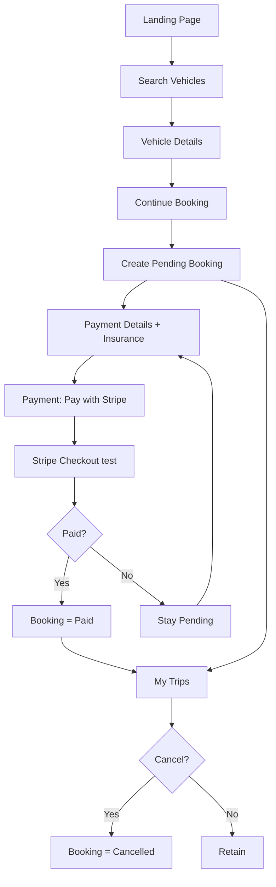

# Product Requirements Document (PRD)

# Keyloop – Simplified Car Rental Booking

*Prepared by: Senior Business Analyst | Source: BRD-KEYLOOP-2026-10-30 v1.0*

## Document Control

| Field | Details |
|---|---|
| PRD ID | PRD-KEYLOOP-2026-11-02 |
| Product | Keyloop – Simplified Car Rental Booking |
| Version | 0.2 (As-built alignment) |
| Date | 9 November 2026 |
| Source Document | BRD-KEYLOOP-2026-10-30 (v1.0, Draft) |
| Primary User | Anonymous Renter |
| Platform | Browser-based web app (modern desktop browsers) |
| Status | Draft – pending resolution of Open Questions (Section 16) |
| Stakeholders | Business Sponsor, Product Owner, UX, Engineering (Angular), QA |

**Revision history**

| Version | Date | Change |
|---|---|---|
| 0.1 | 2 Nov 2026 | Initial PRD derived from BRD v1.0 |
| 0.2 | 9 Nov 2026 | Stripe Checkout (test), PostgreSQL catalog API, landing URL sync/FAQ/footer; see `docs/requirements/prd-v0.2-delta.md` |

## 1. Purpose and Product Overview

### 1.1 Purpose
This PRD translates the approved business requirements into a product specification that Design, Engineering and QA can build and test against. It defines **what** the product does, for whom, and how success is measured.

### 1.2 Product Summary
Keyloop is a lightweight, browser-based car rental booking demo. An anonymous renter can browse a catalogue of vehicles (from the API), search by pickup location and dates, create a booking, choose insurance, pay via **Stripe Checkout in test mode** (no card fields in the app), and manage all bookings made in the current browser tab through **My Trips**.

### 1.3 Product Positioning
This release is an **end-to-end journey demonstrator**. It is not a production marketplace, not a payment platform, and not a system of record.

## 2. Problem Statement and Opportunity

Without a defined booking lifecycle and a central trip history, renters face:

- difficulty tracking multiple bookings;
- inconsistent booking statuses and confusion between Pending and Paid;
- loss of visibility into earlier bookings;
- unclear rental and insurance charges.

**Opportunity:** a simple, registration-free flow with transparent pricing and one clear booking record per rental removes this friction and demonstrates the full rental journey.

## 3. Goals, Non-Goals and Success Metrics

### 3.1 Product Goals

| # | Goal | BRD Objective |
|---|---|---|
| G1 | Book a car with no registration or login | Obj 1 |
| G2 | Discover vehicles by location and dates | Obj 2 |
| G3 | Consistent lifecycle: Pending → Paid → Cancelled | Obj 3 |
| G4 | Transparent charges and selectable insurance | Obj 4 |
| G5 | View and manage multiple bookings in one session | Obj 5 |
| G6 | Never persist card number or CVV | Obj 6 |
| G7 | Demonstrate a complete journey with seed data and Stripe test payment | Obj 7 |

### 3.2 Non-Goals (Out of Scope)
Registration/authentication/identity verification; permanent customer profiles; host listings and approval; **live/production** card processing; saved cards and emailed receipts; availability management; deposits and real insurance underwriting; starting/ending trips; messaging, ratings, reviews; metro, subsidy and regulatory go/no-go items from the original brief.

### 3.3 Success Metrics and Release Criteria
Because this is a demonstrator without analytics scope, success is measured by **verifiable release criteria**:

| ID | Metric | Target |
|---|---|---|
| SM-1 | Seed vehicles shown on landing page load | 100% of seed records |
| SM-2 | Each booking creation yields a unique, sequential ID (TRP-nnn) | 100% |
| SM-3 | Total recalculates on insurance change | 100% correct vs. formula |
| SM-4 | Successful checkout updates only the targeted booking to Paid | 0 cross-booking side effects |
| SM-5 | Cancelled bookings remain visible in My Trips | 100% |
| SM-6 | Card number / CVV found in storage or logs | 0 occurrences |
| SM-7 | Booking collection retained after same-tab refresh | 100% |
| SM-8 | Blocking/critical defects at UAT exit | 0 |

## 4. Users and Personas

**Primary persona – Anonymous Renter ("Sam")**
A casual renter who wants to compare a few cars, book one or more for different trips, and see their status at a glance without creating an account. Expects clear prices, obvious next steps and the ability to cancel.

**Needs:** speed, price transparency, no sign-up, visibility of all bookings.
**Pain points:** unclear charges, losing track of bookings, uncertainty whether payment succeeded.

No secondary personas (host, admin, support) are in scope.

## 5. Scope

### 5.1 In Scope (MVP)
Vehicle catalogue (API/PostgreSQL) · Landing page (search, URL sync, FAQ, site footer) · Vehicle detail (map) · Booking creation (Pending) · Insurance and charge breakdown · **Stripe Checkout** (test) · Booking status management · My Trips · Cancellation · Session-based persistence · Navigation between stages and My Trips.

### 5.2 Release Plan (MoSCoW)

| Priority | Items |
|---|---|
| **Must** | All FR-1 to FR-5 requirements in Section 8 unless marked otherwise |
| **Should** | Cancellation confirmation dialog (OQ-05); visible Stripe **test mode** notice on payment journey (FR-6.2) |
| **Could** | Sorting/filtering of My Trips by status |
| **Won't (this release)** | Anything listed in 3.2 |

## 6. End-to-End User Journey

1. Renter opens the **Landing page**; seed vehicles are displayed.
2. Renter searches by pickup location, pickup date and return date.
3. Renter selects a vehicle → **Vehicle Detail** page.
4. Renter reviews details and price, then selects **Continue booking**.
5. System creates a **Pending** booking (TRP-001, TRP-002 …) and opens **Payment Details**.
6. Renter selects one insurance tier; charge breakdown updates live.
7. Renter pays via **Pay with Stripe** on Payment Details (or opens **Checkout** summary first).
8. Browser redirects to **Stripe Checkout** (test); renter completes payment with a Stripe test card.
9. On successful session verification → booking becomes **Paid**; cancel/failure → booking stays **Pending**.
10. Renter opens **Trips** (from any journey page) → **My Booked Trips**.
11. Renter may **cancel** a Pending or Paid booking; it stays visible as Cancelled.



## 7. User Stories and Acceptance Criteria

### Epic 1 – Vehicle Discovery

**US-1.1** *As a renter, I want to see available vehicles when I open the site so that I can start browsing immediately.*
- Given the landing page loads, then all seed vehicles display with photo, name, location, daily price.

**US-1.2** *As a renter, I want to search by location and dates so that I find relevant vehicles.*
- Given I enter a **location** and search, then matching vehicles are shown (dates validate the rental window; they do not filter catalogue — OQ-08).
- Given I search, then location and dates appear in the **URL** and survive refresh.
- Given no match, then an informative no-results message is shown (not a blank page).
- Selecting a card opens that vehicle's detail page with location and dates retained.

### Epic 2 – Booking Creation

**US-2.1** *As a renter, I want to start a booking from a vehicle page so that I can reserve it.*
- Given no valid dates, then **Continue booking** is disabled.
- Given return date ≤ pickup date, then validation error shown and button stays disabled.
- Given valid dates, when I select Continue booking, then a new Pending booking is created with unique ID, vehicle, location, dates and creation timestamp, and I land on Payment Details.
- Creating a second booking does not overwrite the first.

### Epic 3 – Insurance and Charges

**US-3.1** *As a renter, I want to choose insurance and see my full cost so that there are no surprises.*
- Exactly one tier (Basic/Standard/Premium) must be selected before Continue is enabled.
- Breakdown shows: daily price, rental days, base amount, insurance, platform fee (single line), total.
- Changing insurance updates insurance line and total immediately.

### Epic 4 – Stripe Checkout (test)

**US-4.1** *As a renter, I want to pay securely in test mode so that I can confirm my booking.*
- App never collects PAN, expiry, or CVV; payment uses Stripe Checkout hosted fields.
- Server computes payable total; client creates a Checkout Session via API.
- Successful return + session verification: only this booking changes Pending → Paid.
- Cancelled or failed payment: booking stays Pending; other bookings untouched.
- Payment journey pages show a clear **Stripe test mode** notice; no live charges in test mode.

### Epic 5 – My Trips

**US-5.1** *As a renter, I want a single list of all my bookings so that I can track them.*
- Trips link is available on Landing, Vehicle Detail, Payment Details and Card Checkout.
- All session bookings are listed with Pending, Paid and Cancelled statuses.
- Each entry shows vehicle name, pickup location, pickup/return dates, status, booking ID, booking creation date, in that visual hierarchy.
- New bookings appear alongside existing ones; list survives same-tab refresh; new tab starts empty.
- Empty state shows exactly **"You haven't booked any trips yet"** plus a button to the landing page.

**US-5.2** *As a renter, I want to cancel a booking so that I can undo a plan.*
- Cancel is available for Pending and Paid only.
- Status becomes Cancelled; record and details remain visible; other bookings unaffected.
- Cancelled bookings offer no further actions (terminal).

## 8. Functional Requirements

| ID | Requirement | Priority | BRD Ref |
|---|---|---|---|
| FR-1.1 | Display seed vehicles on initial load | Must | BR-1, FR-1.1 |
| FR-1.2 | Vehicle card shows photo, name, location, daily price | Must | FR-1.2 |
| FR-1.3 | Search by pickup location, pickup date, return date | Must | BR-2 |
| FR-1.4 | Show results matching criteria | Must | FR-1.4 |
| FR-1.5 | No-results message when nothing matches | Must | FR-1.5 |
| FR-1.6 | Card selection opens detail page | Must | FR-1.6 |
| FR-1.7 | Successful Search writes `location`, `pickupDate`, `returnDate` to URL; refresh restores state | Must | Journey |
| FR-2.1 | Detail page shows name, photo, location, daily price | Must | BR-3 |
| FR-2.2 | Retain search location and dates on navigation | Must | FR-2.2 |
| FR-2.3 | Continue booking disabled until valid dates set | Must | RULE-03 |
| FR-2.4 | Validate return date later than pickup date | Must | RULE-04 |
| FR-2.5 | Create booking record with ID, vehicle, location, dates, creation time, status Pending | Must | BR-4 |
| FR-2.6 | Append new booking; never overwrite existing | Must | RULE-05 |
| FR-2.7 | Redirect to Payment Details for that booking | Must | FR-2.7 |
| FR-3.1 | Payment page shows vehicle and rental info | Must | FR-3.1 |
| FR-3.2 | Exactly one insurance option required to proceed | Must | RULE-09 |
| FR-3.3 | Offer Basic 500 / Standard 1,000 / Premium 1,500 (currency TBC) | Must | FR-3.3 |
| FR-3.4 | Breakdown: daily price, days, base, insurance, platform fee, total | Must | BR-5 |
| FR-3.5 | Base amount = Daily Price × Rental Days | Must | FR-3.5 |
| FR-3.6 | Insurance change updates charges instantly | Must | FR-3.6 |
| FR-3.7 | Platform fee shown as one line | Must | FR-3.7 |
| FR-3.8 | Payment: **Pay with Stripe** (primary); optional link to checkout summary route | Must | FR-3.8 |
| FR-4.1 | Checkout route shows booking/payment summary and starts Stripe when requested | Must | FR-4.1 |
| FR-4.2 | **No** in-app card fields; redirect to Stripe Checkout | Must | BR-6 |
| FR-4.3 | API `POST /api/payments/checkout-session` with booking, vehicle, tier, dates | Must | — |
| FR-4.4 | API verifies session; client marks booking Paid only when verified | Must | — |
| FR-4.5 | Card data never in sessionStorage, localStorage, or app logs | Must | BR-11, RULE-14 |
| FR-4.6 | On success update only the target booking Pending → Paid | Must | BR-7 |
| FR-4.7 | N/A — no card data retained in app | Must | FR-4.7 |
| FR-4.8 | On Stripe cancel/error show message; booking stays Pending | Must | RULE-08 |
| FR-4.9 | Stripe **test mode** only in this demo; amounts server-computed | Must | FR-4.9 |
| FR-5.1 | Trips nav on Landing, Detail, Payment, Checkout | Must | FR-5.1 |
| FR-5.2 | Trips opens My Booked Trips | Must | FR-5.2 |
| FR-5.3 | Display every session booking | Must | BR-8 |
| FR-5.4 | Show Pending, Paid, Cancelled statuses | Must | FR-5.4 |
| FR-5.5 | Entry shows vehicle, location, dates, status, ID, creation date | Must | FR-5.5 |
| FR-5.6 | Visual hierarchy: trip info → status → ID → creation date | Must | FR-5.6 |
| FR-5.7 | Sequential IDs per session: TRP-001, TRP-002 … | Must | RULE-10 |
| FR-5.8 | New bookings appear alongside existing | Must | FR-5.8 |
| FR-5.9 | Collection survives same-tab refresh | Must | BR-10 |
| FR-5.10 | New or reopened tab starts empty | Must | RULE-15 |
| FR-5.11 | Empty state: exact text "You haven't booked any trips yet" + button to landing | Must | FR-5.11 |
| FR-5.12 | Cancel Pending or Paid booking | Must | BR-9 |
| FR-5.13 | Cancellation sets status to Cancelled | Must | FR-5.13 |
| FR-5.14 | Cancelled bookings remain visible | Must | RULE-12 |
| FR-5.15 | Cancelling one booking never changes another | Must | RULE-13 |
| FR-6.1 | Confirmation dialog before cancelling | Should | OQ-05 |
| FR-6.2 | Visible Stripe **test mode** notice on payment and checkout pages | Should | RISK-02 |
| FR-6.3 | ~~Session tab loss notice on all pages~~ **Withdrawn in v0.2** (optional doc/FAQ only) | — | RISK-01 |
| FR-6.4 | Landing: FAQ section and site footer with explore links | Should | UX |

## 9. Business Rules and Status Lifecycle

| Status | Definition | Allowed Actions |
|---|---|---|
| Pending | Booking created; Stripe payment not yet verified | Pay with Stripe, Cancel |
| Paid | Stripe session verified successful | Cancel |
| Cancelled | Renter cancelled (terminal) | View only |

**Allowed transitions:** New → Pending; Pending → Paid; Pending → Cancelled; Paid → Cancelled. All others are prohibited. Rebooking after cancellation creates a **new** booking.

**Key rules** (full list RULE-01 to RULE-15 in BRD): no authentication; seed-data only; return date must be after pickup date; one booking record per Continue booking; exactly one insurance tier; failed checkout leaves Pending; card number/CVV never persisted; bookings exist only within the browser session.

## 10. Pricing and Calculation Logic

```
Rental Days      = per OQ-03 (proposed default: return date − pickup date, in calendar days)
Base Rental      = Daily Rental Price × Rental Days
Insurance Amount = value of selected tier (500 / 1,000 / 1,500)
Platform Fee     = per OQ-02 (single line item)
Total Payable    = Base Rental + Insurance Amount + Platform Fee
```

**Worked example (illustrative, assumed values):** daily price 100, 3 days, Standard insurance (1,000), platform fee 50 → Base 300 + 1,000 + 50 = **1,350**. Switching to Basic gives 850 immediately.

> **BA note:** Insurance tiers appear as flat amounts (500–1,500) that could exceed the rental cost itself. Confirm with the business that these are flat per-booking amounts and not per-day, and sanity-check seed prices accordingly (OQ-01, OQ-04).

## 11. Page and UX Requirements

| Page | Key Elements | Required Navigation |
|---|---|---|
| Landing | Search (URL sync), results grid, FAQ (`#faq`), Photon location assist | Trips, FAQ, vehicle detail |
| Vehicle Detail | Photo, name, location, map, price, dates, **Continue booking** | Trips, back to results |
| Payment Details | Insurance, breakdown, **Pay with Stripe**, optional checkout summary link | Trips |
| Checkout | Summary, Stripe redirect, return verify (`session_id`), test notice | Trips |
| Site chrome | Footer on all routes (search, trips, FAQ anchor) | — |
| My Booked Trips | Booking list (all statuses), Cancel action, empty state with CTA | Landing (empty-state CTA) |

**UX principles:** clear single primary action per page; inline validation messages; status shown as distinct visual badges (Pending, Paid, Cancelled) not by colour alone; never show a Paid state without successful validation.

## 12. Data Requirements

### 12.1 Vehicle (seed)
Vehicle ID · Name · Photograph · Rental Location · Daily Rental Price. Fixed collection; content to be supplied (OQ-04).

### 12.2 Booking

| Field | Description |
|---|---|
| Booking ID | Unique sequential session ID (TRP-001…) |
| Vehicle ID / Vehicle Name | Selected vehicle |
| Pickup Location | Rental pickup location |
| Pickup Date / Return Date | Rental period |
| Booking Date | Creation date and time |
| Daily Price / Rental Days | Pricing inputs |
| Insurance Tier / Insurance Amount | Selected insurance |
| Platform Fee / Total Amount | Calculated charges |
| Status | Pending, Paid, Cancelled |

**Excluded from storage:** card number, CVV, and any full card details.

### 12.3 Session Storage
Bookings are held as an **array**, not a single object. Implementation may use an Angular session-state service backed by `sessionStorage`. Storage must support multiple records and individual updates, survive same-tab refresh, start empty in a new tab, and is **not** an authoritative record.

## 13. Non-Functional Requirements

| ID | Category | Requirement |
|---|---|---|
| NFR-01 | Usability | Clear navigation and understandable actions throughout the journey |
| NFR-02 | Performance | Catalogue loads from API; responsive feedback while fetching |
| NFR-03 | Security | Card data never in browser storage or logs |
| NFR-04 | Data integrity | Updating one booking never alters others |
| NFR-05 | Reliability | Bookings persist across same-tab refresh while session active |
| NFR-06 | Maintainability | All booking operations go through one session-level booking service/collection |
| NFR-07 | Compatibility | Supports the agreed modern desktop browsers |
| NFR-08 *(proposed)* | Accessibility | Form labels, keyboard navigation and visible focus (target WCAG 2.1 AA) – to confirm |
| NFR-09 *(proposed)* | Performance | Charge recalculation reflected in UI without perceptible delay |

## 14. Technical Considerations

- Front end: Angular 21 standalone SPA; booking state via `BookingSessionService` + `sessionStorage`.
- Back end: ASP.NET Core 8 API — PostgreSQL catalogue/config; Stripe Checkout Session create/verify (`PaymentsController`).
- No in-app card fields; Stripe secret via API user secrets only.
- Search context in URL query params between landing and vehicle detail.
- Booking ID generation: sequential counter derived from the session collection (TRP-%03d).
- Booking updates must be keyed by Booking ID (no whole-array overwrite) to satisfy NFR-04.

## 15. Assumptions, Constraints, Dependencies and Risks

### 15.1 Assumptions
No accounts; bookings belong to the browser tab session; each Continue booking adds a record; payment uses Stripe test mode (no live charges); My Trips shows all statuses; catalogue served from API.

### 15.2 Constraints
Anonymous renters only; session-limited bookings; nine-vehicle catalogue (USD, $5 platform fee, insurance tiers 500/1000/1500); Stripe test payments only; no PAN/CVV in client storage.

### 15.3 Dependencies
Business confirmation of currency, fee rules and duration rule; seed catalogue content and images; UX designs; agreed browser list.

### 15.4 Risks

| ID | Risk | Mitigation |
|---|---|---|
| RISK-01 | Session end loses booking history | Document in FAQ; no persistent server bookings |
| RISK-02 | Test checkout mistaken for live payment | FR-6.2 Stripe test labelling (FR-4.9) |
| RISK-03 | Currency and fee rules not finalized | Resolve OQ-01/02/03 before build of FR-3 |
| RISK-04 | Client-side storage is non-authoritative and editable | Restrict to demo-level state; no sensitive data |

## 16. Open Questions and BA Recommendations

| ID | Question | Recommended Default (for decision) | Owner | Status |
|---|---|---|---|---|
| OQ-01 | Currency for prices/insurance | **USD** | Business | Closed |
| OQ-02 | Platform fee amount/method | **$5 USD** flat | Business | Closed |
| OQ-03 | Day-count rule | Calendar days (min 1) | Business | Closed |
| OQ-04 | Seed vehicle names, locations, prices | **9 vehicles**, Sydney/Melbourne/Brisbane/Perth | Product/Business | Closed |
| OQ-05 | Cancel confirmation dialog | Yes – confirm before cancelling | Product | To confirm |
| OQ-06 | Cancel Paid bookings immediately | Allowed per current scope; no refund simulation | Product | To confirm |
| OQ-07 | Card/date validation rules | Name non-empty; card 13–19 digits (optionally Luhn); expiry MM/YY not in past; CVV 3–4 digits | Product/QA | To confirm |

**Additional gaps identified by BA (new):**

| ID | Gap | Recommendation |
|---|---|---|
| OQ-08 | Date search vs catalogue | **Closed:** location filters API; dates validate range only |
| OQ-09 | Past pickup dates | Block pickup dates earlier than today |
| OQ-10 | Maximum rental length | Define an upper limit or state none |
| OQ-11 | Same vehicle booked twice for overlapping dates | Allow (no availability) or warn – decide |
| OQ-12 | Is insurance choice saved to the Pending booking if renter leaves before checkout? | Yes – persist tier and totals on the booking |
| OQ-13 | Can renter resume checkout of a Pending booking from My Trips? | Recommend a "Complete payment" action on Pending items (Should) |
| OQ-14 | Booking ID sequence after a Cancelled booking or refresh | IDs never reused within session |

## 17. Acceptance and UAT Scenarios

| # | Scenario | Expected Result |
|---|---|---|
| UAT-1 | Open landing page | All seed vehicles shown |
| UAT-2 | Search with no matching vehicles | No-results message |
| UAT-3 | Open vehicle without dates | Continue booking disabled |
| UAT-4 | Return date ≤ pickup date | Validation error; no booking |
| UAT-5 | Create two bookings in a row | TRP-001 and TRP-002 both listed |
| UAT-6 | Change insurance tier | Total updates immediately |
| UAT-7 | Proceed without insurance | Blocked |
| UAT-8 | Stripe payment cancelled or fails | Booking remains Pending; message shown |
| UAT-9 | Successful Stripe pay on TRP-002 | Only TRP-002 becomes Paid |
| UAT-10 | Inspect storage and logs after checkout | No card number or CVV present |
| UAT-11 | Cancel Pending and Paid bookings | Both show Cancelled and remain listed |
| UAT-12 | Refresh same tab | Booking list retained |
| UAT-13 | Open new independent tab | Empty state with exact message and CTA |
| UAT-14 | Open Trips from Landing, Detail, Payment, Checkout | My Booked Trips opens each time |

## 18. Traceability Matrix

| BRD Requirement | PRD Coverage |
|---|---|
| BR-1 | FR-1.1, FR-1.2, US-1.1 |
| BR-2 | FR-1.3 – FR-1.5, US-1.2 |
| BR-3 | FR-2.1, FR-2.2 |
| BR-4 | FR-2.3 – FR-2.7, US-2.1 |
| BR-5 | FR-3.1 – FR-3.8, US-3.1 |
| BR-6 | FR-4.1 – FR-4.4, FR-4.9, US-4.1 |
| BR-7 | FR-4.6, FR-4.7 |
| BR-8 | FR-5.1 – FR-5.11, US-5.1 |
| BR-9 | FR-5.12 – FR-5.15, US-5.2 |
| BR-10 | FR-5.9, FR-5.10, NFR-05 |
| BR-11 | FR-4.5, NFR-03, UAT-10 |

## 19. Glossary

| Term | Meaning |
|---|---|
| Renter | Anonymous end user booking a vehicle |
| Booking | One session-level record created by Continue booking |
| Pending / Paid / Cancelled | Booking statuses defined in Section 9 |
| Stripe Checkout (test) | Hosted payment page; server-computed amount; test cards only |
| Seed vehicle | Predefined vehicle record bundled with the app |
| My Trips | Booking history page for the current browser session |

## 20. Approval

| Role | Name | Decision | Date |
|---|---|---|---|
| Business Sponsor | | | |
| Product Owner | | | |
| Engineering Lead | | | |
| QA Lead | | | |
