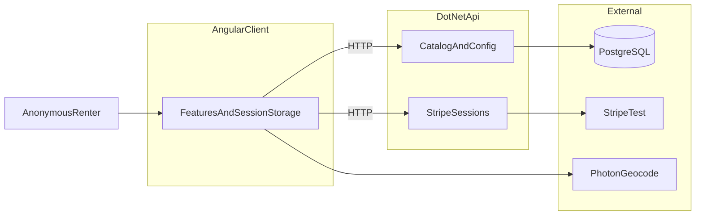

# Keyloop rental demo - System Context

## System Overview

The system is a local Angular 21 client and a .NET 8 API. The client owns the booking journey in `sessionStorage`. The API owns the catalogue, pricing config, and Stripe Checkout session create/verify. PostgreSQL (or the in-memory seed) stores vehicles and config only.

## Context Diagram

## External Integrations

- **PostgreSQL**: Catalogue and pricing config. Optional in local dev when `Database:UseInMemory` is true. The seed is still 9 vehicles and the same config.
- **Stripe Checkout (test)**: Hosted payment page. The API holds `Stripe:SecretKey` and `Stripe:ClientUrl` (`http://localhost:4200`). Success returns to checkout with `stripe=success` and `session_id`.
- **Photon**: Client-side location autocomplete. Labels are normalised to the four catalogue cities. Photon is not a booking dependency.

## Boundaries

| Server | Client |
|--------|--------|
| Vehicles, config, insurance tiers, platform fee | Bookings array `keyloop.bookings.v1` |
| Stripe Checkout session create and verify | Redirect to Stripe. Never store PAN or CVV |
| Amount computed from vehicles, config, and tiers | Pricing UI mirrors the formula |

## HTTP contract

Base URL: `http://localhost:5077`. CORS origin: `http://localhost:4200`.

| Method | Path | Result |
|--------|------|--------|
| GET | `/api/vehicles?location=` | Array of vehicles, or `[]` when the location is unknown |
| GET | `/api/vehicles/{id}` | 200 vehicle, or 404 |
| GET | `/api/config` | USD, platform fee 5, three tiers, `calendarDaysMin1` |
| POST | `/api/payments/checkout-session` | `checkoutUrl`. 400 invalid input, 502 Stripe error, 503 secret missing |
| GET | `/api/payments/session/{sessionId}` | `paid`, `bookingId`, and Stripe fields used to mark the session booking Paid |

Vehicle fields: `id`, `name`, `imageUrl`, `location`, `dailyPriceUsd`, `features`, `rules`.

## High-Level Constraints

- This repo's `client/` and `server/` are the code roots. `../Keyloop` is read-only.
- No booking REST API.
- Search context is URL query params. Booking context is the `bookingId` route param plus session storage.
- Create a booking only from Continue booking on vehicle detail.

## Key NFR Goals

- Loading and empty states for catalogue fetch.
- Charge totals update in the UI immediately.
- No card data in storage or logs.
- One booking service mutates the session collection by id.
- Basic accessibility: skip link, landmarks, labels, visible focus.
