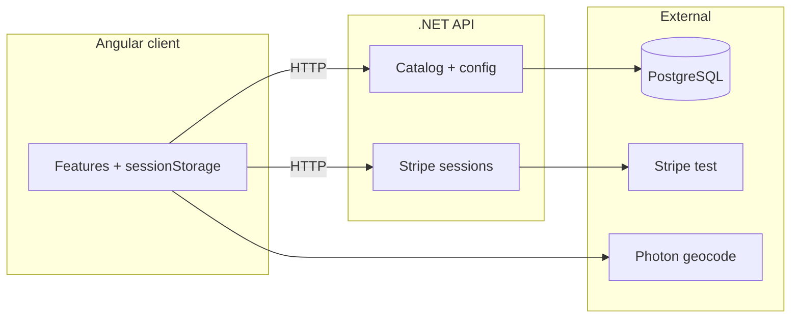

# Architecture — Keyloop

## Context

## Boundaries

| Server | Client |
|--------|--------|
| Vehicles, config, insurance tiers, platform fee | Bookings array `keyloop.bookings.v1` |
| Stripe Checkout Session create/verify | Redirect to Stripe; never store PAN/CVV |
| Amount computed server-side | Pricing UI mirrors formula |

## Key endpoints

See [`../docs/architecture/backend-api.md`](../docs/architecture/backend-api.md).

## Reference layout

[`../docs/guide/project-layout.md`](../docs/guide/project-layout.md)  
[`../docs/architecture/solution-architecture.md`](../docs/architecture/solution-architecture.md)

## Local development

[`../docs/guide/backend-development.md`](../docs/guide/backend-development.md)  
[`../docs/guide/stripe-test-setup.md`](../docs/guide/stripe-test-setup.md)
